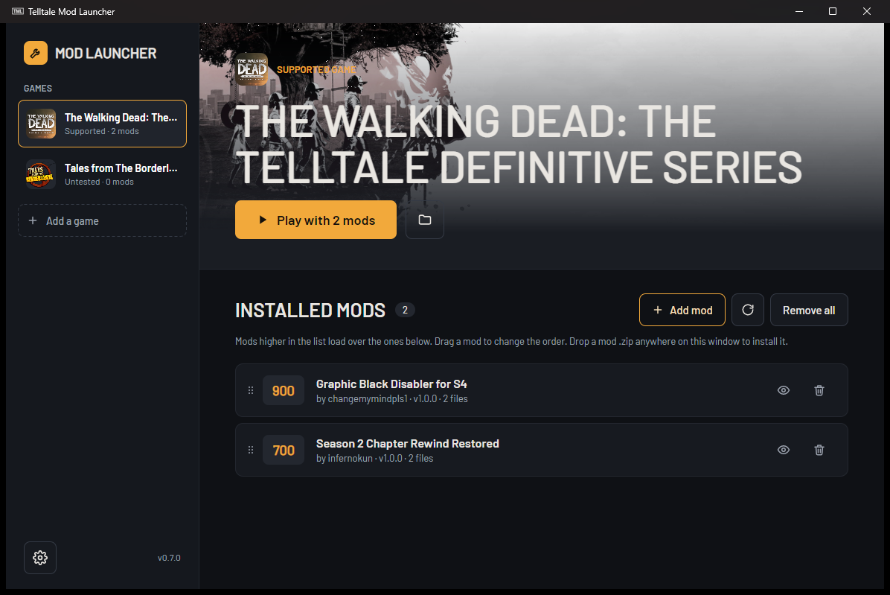
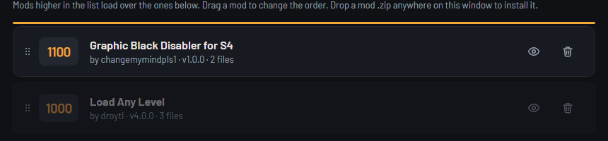

# Telltale Mod Launcher

[](https://github.com/infernokun/TelltaleModLauncher/releases/latest)
[](https://github.com/infernokun/TelltaleModLauncher/releases)
[](https://dotnet.microsoft.com/download/dotnet/10.0)
[](#download)
[](LICENSE)

Install, order and remove mods for The Walking Dead: The Telltale Definitive Series and other Telltale games.

This is my fork of the [Telltale Modding Group's launcher](https://github.com/Telltale-Modding-Group/TelltaleModLauncher). The last upstream release was 0.6.5, a Windows-only WPF app that no longer built from a clean clone. Version 0.7.0 rebuilds it on .NET 10 and Avalonia, so it runs on Windows and Linux, and fixes the bugs that were losing people's mods.



## Download

**Latest: [0.7.0](https://github.com/infernokun/TelltaleModLauncher/releases/tag/v0.7.0)**

| Platform | Download |
|---|---|
| Windows (x64) | [TelltaleModLauncher-v0.7.0-win-x64.zip](https://github.com/infernokun/TelltaleModLauncher/releases/download/v0.7.0/TelltaleModLauncher-v0.7.0-win-x64.zip) |
| Linux (x64) | [TelltaleModLauncher-v0.7.0-linux-x64.tar.gz](https://github.com/infernokun/TelltaleModLauncher/releases/download/v0.7.0/TelltaleModLauncher-v0.7.0-linux-x64.tar.gz) |
| Checksums | [SHA256SUMS.txt](https://github.com/infernokun/TelltaleModLauncher/releases/download/v0.7.0/SHA256SUMS.txt) |

Both builds are self-contained, so there's no .NET runtime or anything else to install. Extract it anywhere and run `TelltaleModLauncher` (`TelltaleModLauncher.exe` on Windows).

Older releases and notes are on the [Releases page](https://github.com/infernokun/TelltaleModLauncher/releases).

## Getting started

1. Click **Add a game** and pick the game's exe. For a Steam copy the launcher fills in the rest, including the mods folder.
2. Drop a mod's `.zip` anywhere on the window, or use **Add mod**.
3. Press **Play**.

On Linux, point it at the game's exe inside your Steam library (for example `~/.local/share/Steam/steamapps/common/<game folder>`). Play starts the game through Steam so it runs under Proton. A copy that isn't in a Steam library runs with Wine if `wine` is installed.

Your setup is saved in `Documents\TelltaleModLauncher` on Windows and `~/.config/TelltaleModLauncher` on Linux.

## What's new in 0.7.0

- **Windows and Linux** from the same code, on .NET 10 and Avalonia.
- **New layout.** Your games sit in a sidebar, the selected game shows at the top with its own icon and Steam's artwork, and its mods are listed below.
- **More than one game** can be set up at once.
- **Drag to set the load order.** The list is the load order: a mod higher up wins over the ones below it.
- **Only a mod's own files are installed.** Readmes, install scripts and other extras in a zip stay out of the game folder.
- **Mods are no longer lost.** Missing files are flagged in the list instead of the mod being deleted at startup.
- **Light and dark themes.**

The full list is in [changes.txt](changes.txt).

## Load order



When two mods change the same file, the game uses the one with the higher priority. That priority lives in each mod's `_resdesc_*.lua`, and most of those files are encrypted.

Drag a mod up or down, or use **Move up** and **Move down** in its right-click menu, and the launcher rewrites the priority inside the mod's files so the game agrees with the list. It handles the encrypted files itself. Updating a mod keeps the place you gave it.

## Fixes from 0.6.5

The upstream launcher had open reports of mods disappearing after a restart and of mods that installed but did nothing. These are fixed:

- **A file watcher race** could fire halfway through an install and delete the mod.
- **The game name** most published mods use, `The_Walking_Dead_Definitive_Edition`, wasn't recognised, so every mod after the first was rejected.
- **macOS junk** (`__MACOSX/._*`) in a zip could be picked up as the mod's info file.
- **Mods with files in subfolders** had their paths flattened, then got deleted at startup for "missing" files.
- **Saving settings** failed now and then on Windows when antivirus or a sync tool had the file open for a moment.

Installs are now staged in a temporary folder first, so a failed install leaves nothing half copied.

## Supported games

Tested with **The Walking Dead: The Telltale Definitive Series**.

Other Telltale games, including Batman, Minecraft: Story Mode, Guardians of the Galaxy and the older titles, can be added from the game list. They're marked as untested, since the launcher has only been tried with the Definitive Series so far.

## For mod authors

A launcher mod is a `.zip` with your files and an info json next to them, named after your mod (for example `modinfo_mymod.json`):

```json
{
  "ModJsonFormatVersion": "1.0.0",
  "ModDisplayName": "Season 2 Chapter Rewind Restored",
  "ModVersion": "1.0.1",
  "ModAuthor": "infernokun",
  "ModCompatibility": "The_Walking_Dead_Definitive_Series",
  "ModFiles": [
    "WDC_pc_Mod_S2Rewind_data.ttarch2",
    "_resdesc_50_Mod_S2Rewind.lua"
  ],
  "ModFilesGameDirectory": [],
  "ModResourcePriority": 700
}
```

- `ModFiles` go in the game's mods folder (Archives for the Definitive Series). Subfolders are kept.
- `ModFilesGameDirectory` go next to the game's exe, for things like `.ini` configs.
- `ModResourcePriority` is your suggested priority. The player can still drag the mod anywhere.
- Archives and resource files you forget to list (`.ttarch2`, `.ttarch`, `.lua`, `.lenc`) are still installed, so older mods keep working.

The [Season 2 Rewind mod](https://github.com/infernokun/TWD-Definitive-Season2-Rewind) is a complete example.

To make mods in the first place, the Telltale Modding Group has tools for [textures](https://github.com/Telltale-Modding-Group/DDS-D3DTX-Converter) and [scripts](https://github.com/Telltale-Modding-Group/Telltale-Script-Editor).

## Building

You need the [.NET 10 SDK](https://dotnet.microsoft.com/download/dotnet/10.0).

```
dotnet build
dotnet test
dotnet run --project src/TelltaleModLauncher
```

To make a single file build for one platform:

```
dotnet publish src/TelltaleModLauncher -c Release -r win-x64 --self-contained -p:PublishSingleFile=true
dotnet publish src/TelltaleModLauncher -c Release -r linux-x64 --self-contained -p:PublishSingleFile=true
```

The code is split into `src/TelltaleModLauncher.Core` (settings, Steam lookup, install, scan, removal and the resource description cipher) and `src/TelltaleModLauncher` (the Avalonia app). Tests are in `tests/TelltaleModLauncher.Tests`, including headless render tests that draw every window. Set `SCREENSHOT_DIR` when running the tests to save those renders.

## Credits

- The original launcher is by David Matos ([frostbone25](https://github.com/frostbone25)) and the [Telltale Modding Group](https://github.com/Telltale-Modding-Group). Their [Discord](https://discord.gg/rn8HvqZjZZ) is the place for Telltale modding in general.
- The resource description cipher is ported from [ttarchext](https://aluigi.altervista.org/papers.htm#ttarchext) by Luigi Auriemma.
- The bundled Barlow fonts are under the SIL Open Font License, included in `src/TelltaleModLauncher/Assets/Fonts/OFL.txt`.

## License

MIT, same as the original. See [LICENSE](LICENSE).
